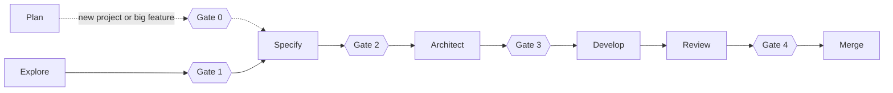

# Agentic SDLC

**Agents propose, humans decide.**

Every gate is a recorded decision and every change is traceable from request to test. Features are sliced the way a product owner would slice them: vertical, small, with an MVP line. Tested end to end on a real security change in a Salesforce codebase.

## What makes it different

- **Human gates are dated, recorded decisions**, not just approvals: each one is a commit with your note.
- **Planning comes before any code**: ideas and features are sliced into small, shippable changes.
- **Risk tiers**: low-risk changes need fewer gates.
- **Per-run cost logging with budget caps**: every agent run is logged, and a stage stops when its budget is used up.

```
/plugin marketplace add salvatoreviticchie/agentic-sdlc-framework
/plugin install sdlc@agentic-sdlc
```

Then type `/sdlc:start`.

## Why

- **Agents do the work, humans decide.** Agents write the specs, the design, the code and the review. You approve or reject at each gate.
- **Everything is traceable.** Every change request, spec, decision, gate and agent run is a file or a commit.
- **Built for existing code.** It starts by reverse-engineering what the code does today, then changes it.

## Quickstart

You need [Claude Code](https://claude.com/claude-code), git and Python 3. In Claude Code, type:

```
/plugin marketplace add salvatoreviticchie/agentic-sdlc-framework
/plugin install sdlc@agentic-sdlc
```

Then, in your project folder:

```
/sdlc:init
```

Follow the **Next:** line at the end of every reply. The step-by-step guide, with a 15-minute practice run on `examples/tiny-app`, is [docs/how-to.md](docs/how-to.md).

## Starting from scratch

1. In an empty folder with `git init -b main`, type `/sdlc:init` and leave the app folder empty.
2. Type `/sdlc:new-project <your idea in one line>`. The planner asks you 5 questions, each with a suggested answer.
3. It writes a product brief, a system design (two stack options and a recommendation) and a plan of small CRs. The first CR is a walking skeleton.
4. Approve the plan with `/sdlc:gate 0 FEAT-001 approve "<note>"`. A new project has no code to explore, so Gate 0 replaces Gate 1.
5. Type `/sdlc:ship FEAT-001` to build the CRs one by one.

## Big features

1. For a change too big for one CR, type `/sdlc:new-feature <description>`.
2. The planner reads what the app does today, asks you 5 questions, and writes `specs/features/FEAT-NNN.md`.
3. The plan is a list of small CRs, ordered by dependency and riskiest first. Each CR is something a user can see, and an MVP line marks the ones you need first.
4. Approve the slicing with `/sdlc:gate 0 FEAT-NNN approve "<note>"`. Only then are its CRs approved.
5. `/sdlc:ship FEAT-NNN` ships them in order. After each merge, `/sdlc:replan FEAT-NNN` updates the rest with what you learned.

## How /sdlc:ship works

- It runs the stages one after another: specify, design, build, review.
- It stops only when a gate is due, and lists the open questions with the agents' proposed defaults.
- To go on, approve at the gate (one command accepts all defaults), then type `/sdlc:ship CR-NNN` again.
- It never pushes or merges. That is up to you.
- It records every stage and gate in `docs/build/CR-NNN-timeline.md`.

## The pipeline



Low-risk changes combine Gates 2 and 3: you review the specs and the design together.

## Commands

| Command | What it does |
|---|---|
| `/sdlc:init` | Sets up your project: folders, `docs/gates.md`, Project settings in `CLAUDE.md` (asks first); running it again changes nothing |
| `/sdlc:start` | Checks the setup, explains the pipeline and says what to run first |
| `/sdlc:explore` | Reverse-engineers the app folder into a system map and baseline specs |
| `/sdlc:new-project <idea>` | Plans a new project: interview, product brief, system design, and a plan of draft CRs |
| `/sdlc:new-feature <description>` | Plans a big feature of the existing app as a plan of draft CRs |
| `/sdlc:replan FEAT-NNN` | Updates a feature's remaining CRs after one is merged |
| `/sdlc:new-cr <description>` | Writes a change request with you, one question at a time |
| `/sdlc:ship CR-NNN` | Runs every stage on its own and stops at each gate |
| `/sdlc:ship FEAT-NNN` | Ships a feature's CRs in order, with the same stops |
| `/sdlc:specify CR-NNN` | Runs the spec-writer only |
| `/sdlc:design CR-NNN` | Runs the architect only |
| `/sdlc:build CR-NNN [slice]` | Runs the developer only, on branch `cr-nnn` |
| `/sdlc:review CR-NNN` | Runs the reviewer only |
| `/sdlc:gate <0-4> [FEAT-NNN \| CR-NNN] approve\|reject "<note>"` | Records your gate decision (Gate 0: the plan of a project or feature) |
| `/sdlc:status` | Shows every CR, its stage and the next command |
| `/sdlc:help [command \| "question"]` | Lists every command, explains one, or answers a question from `docs/how-to.md` and `plugins/sdlc/templates/gates.md` |

The exact records each gate writes are in [gates.md](plugins/sdlc/templates/gates.md), which `/sdlc:init` copies to `docs/gates.md` in your project. How to approve, change or reject at each gate, with examples: [docs/how-to.md](docs/how-to.md#approve-change-or-reject-at-each-gate).

## Agents

| Agent | Reads | Writes | Tools | Never |
|---|---|---|---|---|
| planner | your answers, existing specs, system map | `docs/product-brief.md`, `docs/design/system.md`, `specs/features/FEAT-NNN.md`, draft CRs | Read, Grep, Glob, Write | writes code, or changes a CR that is being built or done |
| explorer | the app folder | `docs/system-map.md`, `docs/coverage.md`, `specs/existing/` | Read, Grep, Glob, Write | changes the app folder |
| spec-writer | the CR, affected specs, system map | `specs/proposed/CR-NNN/`, `docs/traceability.md` | Read, Grep, Glob, Write | writes code or edits `specs/existing/` |
| architect | the CR, proposed specs, system map, code | `docs/design/CR-NNN.md` | Read, Grep, Glob, Write | writes code or edits specs |
| developer | the approved design, `CLAUDE.md` | code and tests in the app folder on branch `cr-nnn`, `docs/build/CR-NNN-report.md` | Read, Grep, Glob, Write, Edit, Bash | commits on main, pushes, or edits specs or the design |
| developer-salesforce | the same, plus the target org | the same, plus `docs/build/CR-NNN-step0.md` | Read, Grep, Glob, Write, Edit, Bash | the same, plus destructive org actions |
| reviewer | the CR, specs, design, build report, changed files | `docs/review/CR-NNN-review.md` | Read, Grep, Glob, Write | changes code, specs or the design |

Inside the plugin they are `sdlc:<name>`; the definitions are in [`plugins/sdlc/agents/`](plugins/sdlc/agents/). An agent runs only from a committed definition (installed from the marketplace: the plugin version).

## Risk tiers

Every CR has `Risk: low` or `Risk: high`.
High risk means security, personal data, money, or anything hard to undo. These go through Gates 2, 3 and 4 separately.
Everything else is low risk: one gate for the specs and the design, then Gate 4. A CR with no Risk line counts as high risk.

## Cost and context

- Run `/clear` between stages. The commands read everything they need from the files.
- Each stage has a budget in `CLAUDE.md`; `/sdlc:ship` stops when one is used up.
- Every agent run is logged to `runs/costs.csv` (ask Claude to "run the sdlc cost report" to sum it).
- On a subscription, the costs are estimates at API prices, not what you are billed.

More in [docs/cost-and-context.md](docs/cost-and-context.md).

## Measured on a real change

The first change request took about 14 calendar days part-time, with about 9 hours of agent time.
Most of the time went to human decisions and environment issues.
`/sdlc:ship`, defaults-first gates and risk tiers address that.
A second, smaller change will be timed with `/sdlc:ship`.

## Status and limits

- Tested end to end on one Salesforce codebase by one person, not yet with a team.
- A documentation agent is planned.
- `developer-salesforce` is provided as an example of a stack-specific developer.

## Lessons

Rules learned from the first real change, in full in [docs/lessons.md](docs/lessons.md):

- Give every loop a stopping rule.
- Implied isn't answered.
- Prompt rules aren't controls.
- Blocked models improvise.
- AI judges can be fooled.
- Build in slices.
- Re-test the neighbours.

## Repository layout

- `.claude-plugin/marketplace.json`: this repository is a plugin marketplace named `agentic-sdlc`.
- `plugins/sdlc/`: the plugin, and the single source of the framework: `agents/`, `skills/` (the `/sdlc:` commands), `templates/` (including `gates.md`, which `/sdlc:init` copies into a project) and `scripts/`.
- `examples/tiny-app/`: the practice app for the walkthrough.

To release a change to the plugin, raise `version` in `plugins/sdlc/.claude-plugin/plugin.json`: installed copies update only when it changes. Check with `claude plugin validate ./plugins/sdlc` and `claude plugin validate .`.

## License

MIT. See [LICENSE](LICENSE).
