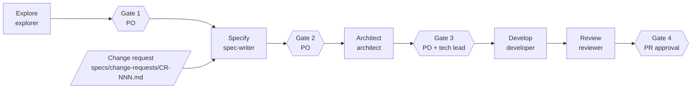

# agentic-sdlc-framework

A small framework for running a software change through a pipeline of
Claude Code agents, with a human gate after every stage. Each agent is a
Markdown definition in `.claude/agents/`; each stage reads the previous
stage's approved output and writes one artifact a human can review.

It is built for brownfield work: the first stage reverse-engineers an
existing codebase into specs, and every later change is described, designed,
built and reviewed against those specs.

## Layout

```
.claude/agents/   explorer, spec-writer, architect, developer, reviewer
app/              the target codebase goes here
docs/             gates.md, lessons.md; agents write system-map, design, build and review notes here
specs/            existing/ (what the code does today), proposed/CR-NNN/, change-requests/
templates/        change-request, spec, design-note, build-report
scripts/          run_agent.py (run an agent and log its cost), cost_report.py
runs/             costs.csv (tracked) and full run outputs (ignored)
```

## Pipeline



Explore runs once per codebase (and again when the baseline drifts).
Specify, Architect, Develop and Review run once per change request (CR).
Gate 4 is the pull request: after merge, the proposed specs replace the
baseline ones in `specs/existing/`.

## The agents

| Agent | Reads | Writes | May use |
|---|---|---|---|
| explorer | everything under `app/` | `docs/system-map.md`, `specs/existing/REQ-NNN.md`, `docs/coverage.md` | Read, Grep, Glob, Write. Never changes `app/`. |
| spec-writer | the approved CR, affected specs in `specs/existing/`, `docs/system-map.md`; `app/` only to confirm current behaviour | `specs/proposed/CR-NNN/REQ-XXX.md`, `specs/proposed/CR-NNN/summary.md`, rows in `docs/traceability.md` | Read, Grep, Glob, Write. Never changes `app/` or `specs/existing/`. |
| architect | the CR with all PO decisions, approved proposed specs, `docs/system-map.md`, `docs/gates.md`, `app/` | `docs/design/CR-NNN.md` | Read, Grep, Glob, Write. Never changes `app/`, `specs/` or `.claude/`. |
| developer | the Gate 3-approved design, the CR, specs, `app/` | code and tests under `app/` on branch `cr-NNN`; `docs/build/CR-NNN-step0.md`, `docs/build/CR-NNN-report.md` | Read, Grep, Glob, Write, Edit, Bash. Never touches main, never pushes or opens PRs. |
| reviewer | the CR, proposed specs, design note, build report (grepped), every changed file | `docs/review/CR-NNN-review.md` | Read, Grep, Glob, Write. Changes nothing else. |

The developer and reviewer definitions contain Salesforce-specific rules,
marked "Salesforce example: adapt for your stack". Replace them with the
equivalents for your platform.

## Running an agent

**Interactive.** Start Claude Code in the repo and ask for the agent by name:

```
claude
> Use the spec-writer agent on CR-002
```

**Headless, with cost logging.** `scripts/run_agent.py` runs one agent with
`claude -p`, saves the full JSON output and logs one cost row:

```
python3 scripts/run_agent.py --agent spec-writer --cr CR-002 --stage specify \
    --prompt "Write the proposed specs for CR-002" \
    --budget 2.00 --permission-mode acceptEdits
```

- `--budget` (default 2.00 USD) is passed as `--max-budget-usd`. The limit is
  checked between turns, so a run can overshoot it; very small budgets stop on
  the first turn.
- `--permission-mode` (default `acceptEdits`) is passed to `claude -p`.
- The script refuses to run if the agent's definition has uncommitted changes.

## Governance rules

From [docs/gates.md](docs/gates.md) and the agent definitions:

- Four human gates: baseline specs (Gate 1), proposed specs (Gate 2),
  design note (Gate 3), pull request (Gate 4).
- A gate is passed only on agent output. No hand edits to agent output before approval.
- Open questions are answered by the PO in the CR, or explicitly deferred
  to a named later stage, before Gate 2.
- `specs/existing/` always describes what the code does today; proposed specs
  move there only after merge.
- An agent runs only from a committed definition. Every run report states
  the prompt version and the commit hash of the definition.
- Every deviation from the design is logged in the build report and needs a
  PO decision at Gate 4.

See [docs/lessons.md](docs/lessons.md) for the rules learned from running it.

## Cost logging

Every run through `scripts/run_agent.py` appends a row to `runs/costs.csv`:
CR, stage, agent, prompt version, definition commit, session ID, models,
input/output/cache tokens, cost, duration, turns, budget, permission mode,
and whether the budget stopped the run. The full JSON goes to
`runs/<timestamp>-<cr>-<stage>.json`, which is git-ignored because it can
contain file contents.

```
python3 scripts/cost_report.py
```

prints cost and tokens per CR and stage, with totals.

**Note:** the costs are Claude Code's client-side estimates at API prices
(`total_cost_usd`), not amounts billed on a subscription.

## Status

- Tested end to end (Explore through Gate 4) on one Salesforce pilot, by one person.
- Not yet used by a team.
- Planned: a documentation agent.

## License

MIT, see [LICENSE](LICENSE).
